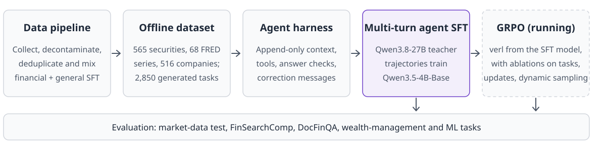
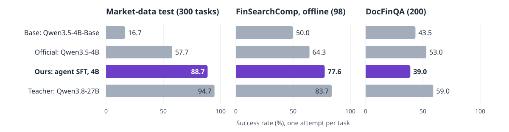

<h1 align="center">Post-Training a Financial LLM Agent</h1>

<div align="center">
  <p>
    <a href="README.zh-CN.md"></a>
    <a href="LICENSE"></a>
    <a href="https://github.com/volcengine/verl"></a>
  </p>
</div>


## 🔗 Links

- [Overview](#-overview) | [Method](#-method) | [Results](#-results)
- [Project Structure](#-project-structure) | [Environment Setup](#-preliminary)
- [Train from Scratch](#-train-from-scratch) | [Acknowledgement](#-acknowledgement)


<!-- Overview Section -->
<h3 align="center">📌 Overview</h3>

<p align="center">
  This project post-trains the 4B base model Qwen3.5-4B-Base into a tool-using financial agent that looks up market prices, macroeconomic series and company filings, computes over them in a Python sandbox and answers multi-step questions. With a self-built data pipeline and multi-turn agent SFT, the 4B model solves 88.7% of the 300-task market-data test, against 57.7% for the official Qwen3.5-4B and 94.7% for its Qwen3.8-27B teacher. GRPO from the SFT model is in progress.
</p>

<!-- Method Section -->
<h3 align="center">🧠 Method</h3>

<p align="center">
  A data pipeline collects, decontaminates, deduplicates and mixes financial and general SFT data, and builds an offline snapshot of market, macroeconomic and SEC filing data with program-answered tasks. A Qwen3.8-27B teacher solves the training tasks in an append-only agent harness, and its filtered trajectories train the SFT model M1 with multi-turn agent SFT. GRPO in verl continues from M1.
</p>

<p align="center">
  
</p>


<!-- Results Section -->
<h3 align="center">📊 Results</h3>

<p align="center">
  <b>Multi-turn agent SFT takes the 4B model from 16.7% to 88.7% on the market-data test, 31.0 points above the official Qwen3.5-4B.</b>
</p>

<p align="center">
  
</p>

| **Model** | **Market-data test (300)** | **FinSearchComp, offline (98)** | **DocFinQA (200)** | **Wealth management + ML (550)** |
|:---|:---:|:---:|:---:|:---:|
| Start model Qwen3.5-4B-Base | 16.7 | 50.0 | 43.5 | 50.4 |
| Official Qwen3.5-4B | 57.7 | 64.3 | **53.0** | 84.2 |
| **M1: agent SFT, 4B (Ours)** | **88.7** | **77.6** | 39.0 | **91.1** |
| Teacher Qwen3.8-27B | 94.7 | 83.7 | 59.0 | — |

Success rate (%), one attempt per task, graded by program. Bold marks the best 4B model. Market-data test tasks share M1's training task types and use held-out stocks or later periods; FinSearchComp and DocFinQA lie outside those types.

> M1 beats the official Qwen3.5-4B by **+31.0** (95% interval +24.0 to +38.0) on the market-data test, **+13.3** (+3.1 to +23.5) on FinSearchComp and **+6.9** (+3.8 to +10.2) on wealth-management and machine-learning tasks.

<p align="center">
  <b>Multi-turn agent SFT is the biggest single gain.</b>
</p>

On the 550 wealth-management and machine-learning tasks, a model given single-question SFT solves 38.5%. Adding multi-turn agent SFT on the same model raises that to 91.6% (+53.1, 95% interval +48.9 to +57.3).

<p align="center">
  <b>A 1:1 mix of financial and general data gives the best balance.</b>
</p>

On Qwen3-4B-Base with 100,000 SFT samples per run:

| **SFT data** | **Finance score** | **GSM8K** | **General score** |
|:---|:---:|:---:|:---:|
| None (base model) | 70.3 | 82.2 | — |
| Finance only | **75.7** | 51.8 | 56.4 |
| **1:1 finance and general (Ours)** | 74.1 | **81.1** | 72.6 |
| 1:3 finance and general | 72.5 | 80.4 | **73.3** |
| General only | 70.0 | 78.4 | 72.8 |

The 1:1 mix keeps GSM8K within 1.1 points of the base model and gives up only 1.5 finance points against finance-only SFT. The general data includes GSM8K-style training tasks, so part of this gap comes from practice on similar tasks.

<p align="center">
  <b>Synthetic document QA can be dropped from the mix.</b>
</p>

The 1:1 mix scores 74.2 on the finance score without it and 74.1 with it, a difference of 0.05 points (p=0.55).

<p align="center">
  <b>A minimal harness beats the full harness on gpt-oss-120b.</b>
</p>

With the model fixed, the minimal harness H0 solves 78.7% of the self-built test set and the full harness H1 solves 71.3%, a gain of 7.5 points for H0 (95% interval +4.0 to +11.1). The full harness spends the task's step limit on checklist upkeep and on redoing rejected actions, mostly on five-client rebalancing tasks. Harness v3 no longer charges this work to the task.

<p align="center">
  <b>GRPO is a better next step than more distillation from this teacher.</b>
</p>

On 200 development tasks run four times each, M1 scores 88.1% at pass@1 and 99.5% at pass@4, so most remaining failures are tasks it solves on some attempts. The teacher is only 6.0 points above M1 on the market-data test (95% interval +1.7 to +10.3).

<p align="center">
  <b>The conclusions hold under stricter grading.</b>
</p>

A strict regrade changes 10 answers across the market-data evaluations, and M1's conclusions against the start model and the official model stay the same.


## 📂 Project Structure

```
src/
├── 00_shared/                # GPU holder process used by the launchers
├── 01_data-processing/       # Dataset conversion, decontamination, deduplication, mixing
│   ├── code/market_tasks/    #   Market task templates, generation and checks
│   └── utils/market_snapshot/  #   Offline market, FRED and SEC snapshot builder
├── 02_harness/               # Agent harness
│   └── code/v3/              #   Agent loop, task environments, graders and tests
├── 03_model-training/        # Agent SFT data, SFT entry point, GRPO agent loop
│   ├── code/train_q35.py     #   Qwen3.5 SFT entry point
│   └── code/verl_grpo/       #   verl agent loop and dynamic filtering
├── 04_evaluation/            # Scoring, paired comparisons, strict regrader
└── 05_review/                # Cross-stage regression tests

scripts/                      # Launchers by stage
├── 02_harness/               #   Teacher trajectories and task screening
├── 03_model-training/        #   SFT and GRPO launchers
├── 04_evaluation/            #   Checkpoint evaluation
└── rl_chain_c.sh             #   The full GRPO chain

configs/                      # Prompts; LLaMA-Factory, DeepSpeed and verl configurations
environment_installation/     # Build scripts, lock files and local.env.example
outputs/bank/figures/         # Figures used in this README
```


## 📌 Preliminary

### Environment Setup

```shell
# Build the Python environments: fin-posttrain, embed-tf5, vllm-0.12, lmeval,
# llamafactory, train-q35, vllm-0.32, verl and mkt.
# Lock files are in environment_installation/requirements/freeze/ and build
# scripts in environment_installation/install/.

# Set the data, checkpoint, model, cache and environment locations
cp environment_installation/local.env.example environment_installation/local.env
$EDITOR environment_installation/local.env

# Shell launchers read local.env through scripts/paths.sh; for Python modules run
. environment_installation/local.env
```

See [environment_installation/README.md](environment_installation/README.md) for each environment.


## ⭐ Train from Scratch

> **Tip:** Datasets, the market snapshot, task files, trajectories and checkpoints are not in this repository. The GPU launchers call a GPU-claim tool through `GPU_CLAIM_PY` in `local.env`; to run without it, set `CUDA_VISIBLE_DEVICES` directly in the launchers.

### Step 1: Data Preparation

```shell
# Build the market snapshot from the public Yahoo, FRED and SEC endpoints
$FP_VENVS/mkt/bin/python -B src/01_data-processing/utils/market_snapshot/build.py

# Generate the market tasks, both tiers
$FP_VENVS/mkt/bin/python -B src/01_data-processing/code/market_tasks/generate.py --cache-dir <local dir>
$FP_VENVS/mkt/bin/python -B src/01_data-processing/code/market_tasks/generate.py --cache-dir <local dir> --tier hard
```

The tools for decontamination, deduplication and mixing are in `src/01_data-processing/utils/`, each with its usage at the top of the file.

### Step 2: Teacher Trajectories

```shell
# Serve the teacher, then run it on the market training tasks
sh scripts/serve_qwen38.sh <gpu,gpu> 18011 <log file>
sh scripts/02_harness/market_train_teacher.sh
```

### Step 3: Multi-Turn Agent SFT

```shell
# LLaMA-Factory does not expand variables, so render the configuration first
. environment_installation/local.env
envsubst < configs/03_model-training/sft/sft_q35_4b_M1_en.yaml > <tmp>/M1.yaml

$FP_VENVS/train-q35/bin/torchrun --nproc_per_node 6 src/03_model-training/code/train_q35.py <tmp>/M1.yaml
```

### Step 4: GRPO

```shell
# Print each stage's commands and verl configuration without starting anything
cd /tmp && DRY=1 bash <repo>/scripts/rl_chain_c.sh

# Run and stop the chain
cd /tmp && bash <repo>/scripts/rl_chain_c.sh
bash <repo>/scripts/rl_chain_c.sh stop
```

### Step 5: Evaluation

```shell
# Evaluate a checkpoint on the market-data, FinSearchComp, DocFinQA and self-built test sets
bash scripts/04_evaluation/eval_ckpt_c.sh <checkpoint> <name>
```

For FinSearchComp, provide your own copy of the data at `$FP_DATA_D2/finsearchcomp/finsearchcomp_data.json`.


## 📝 Acknowledgement

The implementation is built upon [verl](https://github.com/volcengine/verl), [vLLM](https://github.com/vllm-project/vllm), [LLaMA-Factory](https://github.com/hiyouga/LLaMA-Factory) and [Qwen](https://github.com/QwenLM).

Check each data source's own terms before use:

- **Financial data:** FinQA (MIT on GitHub, CC BY 4.0 on its Hugging Face data card), TAT-QA (CC BY 4.0), DianJin-R1-Data (MIT), BizBench (Apache-2.0), IndustryInstruction finance part and Agentar-DeepFinance-100K (Apache-2.0), finance-alpaca (MIT).
- **Synthetic document QA source:** IndustryCorpus2.
- **General data:** Tülu 3 SFT mixture (ODC-BY).
- **Agent trajectory data:** Nemotron-SFT-Agentic-Finance-v1 (OpenMDW-1.1) and Toucan-1.5M (Apache-2.0).
- **External tests:** FinSearchComp (CC BY 4.0; its reference answers are not redistributed here) and DocFinQA.
- **Market snapshot:** Yahoo daily prices do not allow redistribution, so no snapshot, task or value derived from them is in this repository. FRED series are public, though some stay under their provider's copyright. SEC XBRL company facts are US government public data.

The code is released under the [MIT License](LICENSE). The datasets and models it uses keep their own licenses.
