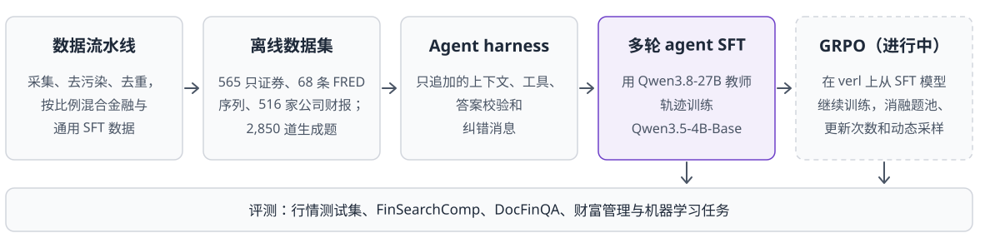
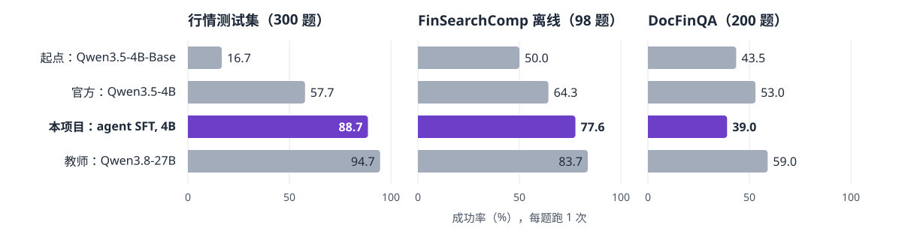

<h1 align="center">后训练金融 LLM Agent</h1>

<div align="center">
  <p>
    <a href="README.md"></a>
    <a href="LICENSE"></a>
    <a href="https://github.com/volcengine/verl"></a>
  </p>
</div>


## 🔗 链接

- [概览](#-概览) | [方法](#-方法) | [结果](#-结果)
- [项目结构](#-项目结构) | [环境配置](#-准备工作)
- [从头训练](#-从头训练) | [致谢](#-致谢)


<!-- Overview Section -->
<h3 align="center">📌 概览</h3>

<p align="center">
  本项目把 4B 底座模型 Qwen3.5-4B-Base 后训练成会调用工具的金融 agent：它查询行情、宏观序列和公司财报，在 Python 沙箱里计算，并回答多步问题。通过自建数据流水线和多轮 agent SFT，4B 模型在 300 题的行情测试集上做对 88.7%，官方 Qwen3.5-4B 为 57.7%，它的教师 Qwen3.8-27B 为 94.7%。从 SFT 模型出发的 GRPO 正在进行。
</p>

<!-- Method Section -->
<h3 align="center">🧠 方法</h3>

<p align="center">
  数据流水线采集、去污染、去重并混合金融和通用 SFT 数据，再构建行情、宏观和 SEC 财报的离线快照，并生成由程序给出答案的任务。Qwen3.8-27B 教师在只追加上下文的 agent harness 中做训练题，过滤后的轨迹用多轮 agent SFT 训练出 SFT 模型 M1。GRPO 在 verl 上从 M1 继续训练。
</p>

<p align="center">
  
</p>


<!-- Results Section -->
<h3 align="center">📊 结果</h3>

<p align="center">
  <b>多轮 agent SFT 让 4B 模型在行情测试集上从 16.7% 升到 88.7%，比官方 Qwen3.5-4B 高 31.0 分。</b>
</p>

<p align="center">
  
</p>

| **模型** | **行情测试集（300）** | **FinSearchComp 离线（98）** | **DocFinQA（200）** | **财富管理 + 机器学习（550）** |
|:---|:---:|:---:|:---:|:---:|
| 起点模型 Qwen3.5-4B-Base | 16.7 | 50.0 | 43.5 | 50.4 |
| 官方 Qwen3.5-4B | 57.7 | 64.3 | **53.0** | 84.2 |
| **M1：agent SFT, 4B（本项目）** | **88.7** | **77.6** | 39.0 | **91.1** |
| 教师 Qwen3.8-27B | 94.7 | 83.7 | 59.0 | — |

成功率（%），每题跑 1 次，由程序判分。粗体标出最好的 4B 模型。行情测试题与 M1 的训练题题型相同，用的是留出的股票或更晚的时间段；FinSearchComp 和 DocFinQA 在这些题型之外。

> M1 比官方 Qwen3.5-4B 高：行情测试集 **+31.0** 分（95% 区间 +24.0 到 +38.0），FinSearchComp **+13.3** 分（+3.1 到 +23.5），财富管理加机器学习任务 **+6.9** 分（+3.8 到 +10.2）。

<p align="center">
  <b>多轮 agent SFT 是提升最大的一步。</b>
</p>

在 550 道财富管理和机器学习任务上，只做单问题 SFT 的模型做对 38.5%；在同一模型上加多轮 agent SFT 后升到 91.6%（+53.1 分，95% 区间 +48.9 到 +57.3）。

<p align="center">
  <b>金融与通用数据 1:1 混合最均衡。</b>
</p>

在 Qwen3-4B-Base 上，每次用 100,000 条 SFT 样本：

| **SFT 数据** | **金融分** | **GSM8K** | **通用分** |
|:---|:---:|:---:|:---:|
| 无（起点模型） | 70.3 | 82.2 | — |
| 只用金融数据 | **75.7** | 51.8 | 56.4 |
| **金融与通用 1:1（本项目）** | 74.1 | **81.1** | 72.6 |
| 金融与通用 1:3 | 72.5 | 80.4 | **73.3** |
| 只用通用数据 | 70.0 | 78.4 | 72.8 |

1:1 混合让 GSM8K 与起点模型只差 1.1 分，金融分只比只用金融数据低 1.5 分。通用数据里有 GSM8K 风格的训练题，这个差距有一部分来自练过相似的题。

<p align="center">
  <b>混合数据可以去掉合成文档问答。</b>
</p>

1:1 混合去掉它时金融分 74.2，保留时 74.1，只差 0.05 分（p=0.55）。

<p align="center">
  <b>在 gpt-oss-120b 上，最小 harness 比完整 harness 更好。</b>
</p>

固定模型时，最小 harness H0 在自建环境测试集上做对 78.7%，完整 harness H1 做对 71.3%，H0 高 7.5 分（95% 区间 +4.0 到 +11.1）。完整 harness 的清单维护和驳回后的重做占用任务的步数上限，主要影响五客户再平衡任务。Harness v3 不再把这部分算进任务的步数。

<p align="center">
  <b>下一步做 GRPO 比继续向这个教师蒸馏更好。</b>
</p>

在 200 道开发题上每题跑 4 次，M1 的 pass@1 为 88.1%，pass@4 为 99.5%，所以剩下的失败大多是有时能做对的题。行情测试集上教师只比 M1 高 6.0 分（95% 区间 +1.7 到 +10.3）。

<p align="center">
  <b>更严格的判分下结论不变。</b>
</p>

严格重判改判了行情评测中的 10 个答案，M1 相对起点模型和官方模型的结论不变。


## 📂 项目结构

```
src/
├── 00_shared/                # 启动器用的占卡进程
├── 01_data-processing/       # 数据转换、去污染、去重、混合
│   ├── code/market_tasks/    #   行情题的模板、生成和校验
│   └── utils/market_snapshot/  #   行情、FRED 和 SEC 离线快照的构建
├── 02_harness/               # Agent harness
│   └── code/v3/              #   Agent 循环、任务环境、判分和测试
├── 03_model-training/        # Agent SFT 数据、SFT 入口、GRPO 的 agent 循环
│   ├── code/train_q35.py     #   Qwen3.5 SFT 入口
│   └── code/verl_grpo/       #   verl agent 循环和动态过滤
├── 04_evaluation/            # 打分、配对比较、严格重判
└── 05_review/                # 跨阶段回归测试

scripts/                      # 按阶段组织的启动器
├── 02_harness/               #   教师轨迹和筛题
├── 03_model-training/        #   SFT 和 GRPO 启动器
├── 04_evaluation/            #   检查点评测
└── rl_chain_c.sh             #   完整的 GRPO 链路

configs/                      # 提示词；LLaMA-Factory、DeepSpeed 和 verl 配置
environment_installation/     # 构建脚本、锁文件和 local.env.example
outputs/bank/figures/         # 本 README 用到的图
```


## 📌 准备工作

### 环境配置

```shell
# 构建 Python 环境：fin-posttrain、embed-tf5、vllm-0.12、lmeval、
# llamafactory、train-q35、vllm-0.32、verl 和 mkt。
# 锁文件在 environment_installation/requirements/freeze/，
# 构建脚本在 environment_installation/install/。

# 设置数据、检查点、模型、缓存和环境的位置
cp environment_installation/local.env.example environment_installation/local.env
$EDITOR environment_installation/local.env

# Shell 启动器经 scripts/paths.sh 读取 local.env；运行 Python 模块前先执行
. environment_installation/local.env
```

各环境的说明见 [environment_installation/README.md](environment_installation/README.md)。


## ⭐ 从头训练

> **提示：** 数据集、行情快照、任务文件、轨迹和检查点不在本仓库。GPU 启动器通过 `local.env` 的 `GPU_CLAIM_PY` 调用取卡工具；不用它时，在启动器里直接设置 `CUDA_VISIBLE_DEVICES`。

### 第 1 步：准备数据

```shell
# 从公开的 Yahoo、FRED 和 SEC 接口构建行情快照
$FP_VENVS/mkt/bin/python -B src/01_data-processing/utils/market_snapshot/build.py

# 生成两档行情题
$FP_VENVS/mkt/bin/python -B src/01_data-processing/code/market_tasks/generate.py --cache-dir <本地目录>
$FP_VENVS/mkt/bin/python -B src/01_data-processing/code/market_tasks/generate.py --cache-dir <本地目录> --tier hard
```

去污染、去重和混合的工具在 `src/01_data-processing/utils/`，用法写在各文件开头。

### 第 2 步：教师轨迹

```shell
# 启动教师服务，再让它做行情训练题
sh scripts/serve_qwen38.sh <gpu,gpu> 18011 <日志文件>
sh scripts/02_harness/market_train_teacher.sh
```

### 第 3 步：多轮 Agent SFT

```shell
# LLaMA-Factory 不展开变量，先渲染配置
. environment_installation/local.env
envsubst < configs/03_model-training/sft/sft_q35_4b_M1_en.yaml > <tmp>/M1.yaml

$FP_VENVS/train-q35/bin/torchrun --nproc_per_node 6 src/03_model-training/code/train_q35.py <tmp>/M1.yaml
```

### 第 4 步：GRPO

```shell
# 打印每个阶段的命令和 verl 配置，不启动任何进程
cd /tmp && DRY=1 bash <仓库>/scripts/rl_chain_c.sh

# 启动和停止链路
cd /tmp && bash <仓库>/scripts/rl_chain_c.sh
bash <仓库>/scripts/rl_chain_c.sh stop
```

### 第 5 步：评测

```shell
# 在行情、FinSearchComp、DocFinQA 和自建环境测试集上评测一个检查点
bash scripts/04_evaluation/eval_ckpt_c.sh <检查点> <名称>
```

FinSearchComp 需要自备数据，放在 `$FP_DATA_D2/finsearchcomp/finsearchcomp_data.json`。


## 📝 致谢

实现基于 [verl](https://github.com/volcengine/verl)、[vLLM](https://github.com/vllm-project/vllm)、[LLaMA-Factory](https://github.com/hiyouga/LLaMA-Factory) 和 [Qwen](https://github.com/QwenLM)。

使用前请查看各数据来源自己的条款：

- **金融数据：** FinQA（GitHub 上为 MIT，Hugging Face 数据卡为 CC BY 4.0）、TAT-QA（CC BY 4.0）、DianJin-R1-Data（MIT）、BizBench（Apache-2.0）、IndustryInstruction 金融部分和 Agentar-DeepFinance-100K（Apache-2.0）、finance-alpaca（MIT）。
- **合成文档问答的来源：** IndustryCorpus2。
- **通用数据：** Tülu 3 SFT（ODC-BY）。
- **Agent 轨迹数据：** Nemotron-SFT-Agentic-Finance-v1（OpenMDW-1.1）和 Toucan-1.5M（Apache-2.0）。
- **外部测试：** FinSearchComp（CC BY 4.0，本仓库不再分发它的参考答案）和 DocFinQA。
- **行情快照：** Yahoo 日线不允许再分发，所以本仓库不含快照，也不含由它得出的任务和数值。FRED 序列是公开的，但部分序列的版权属于原提供方。SEC XBRL 公司数据是美国政府公开数据。

代码以 [MIT License](LICENSE) 发布。所用数据集和模型遵循各自的许可证。
